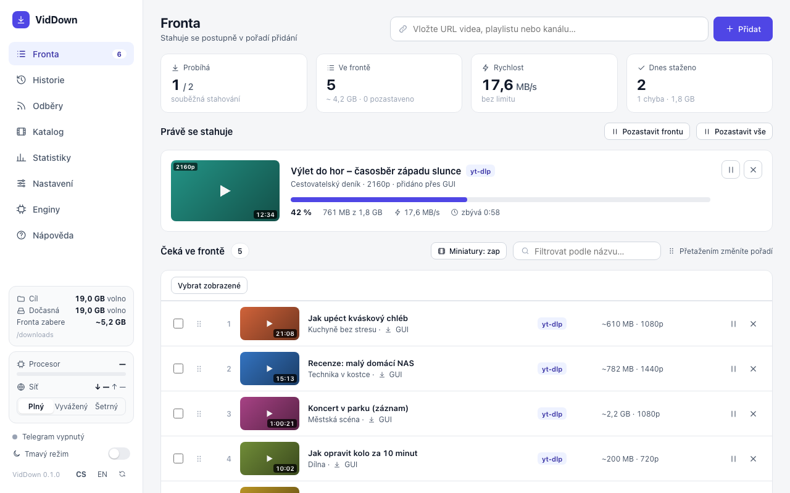
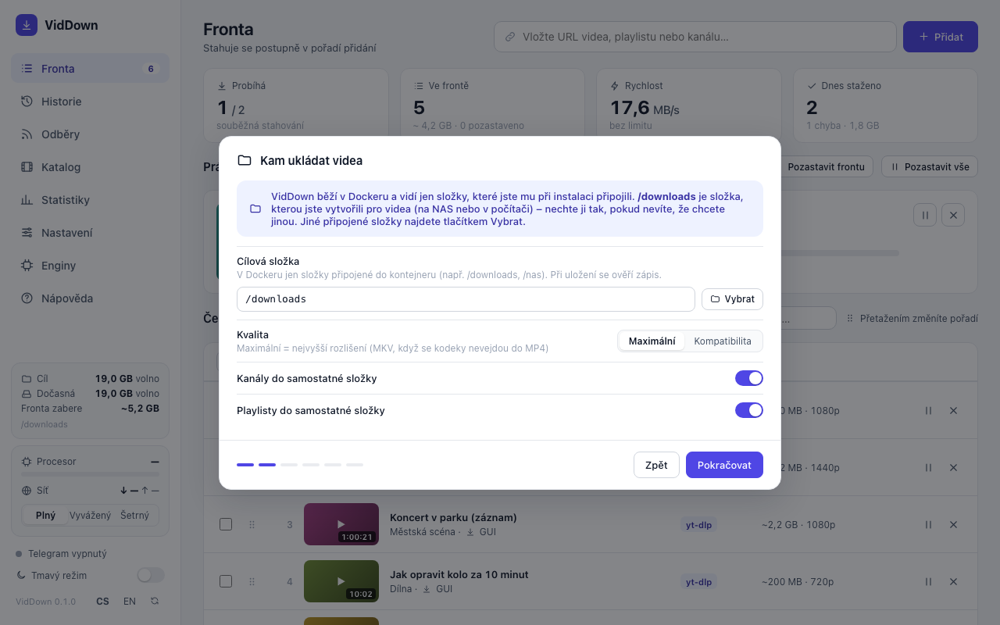
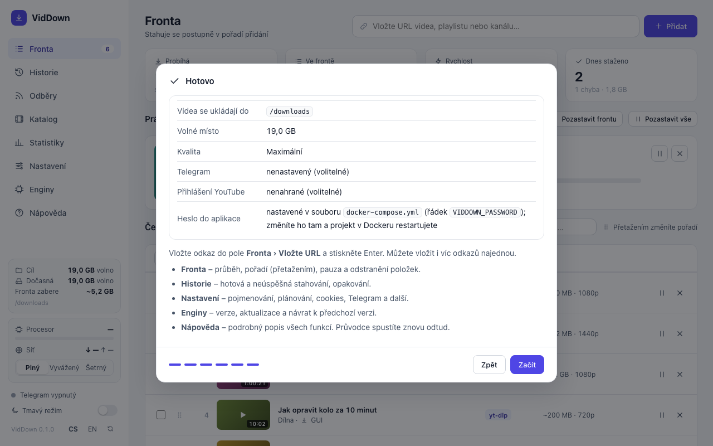
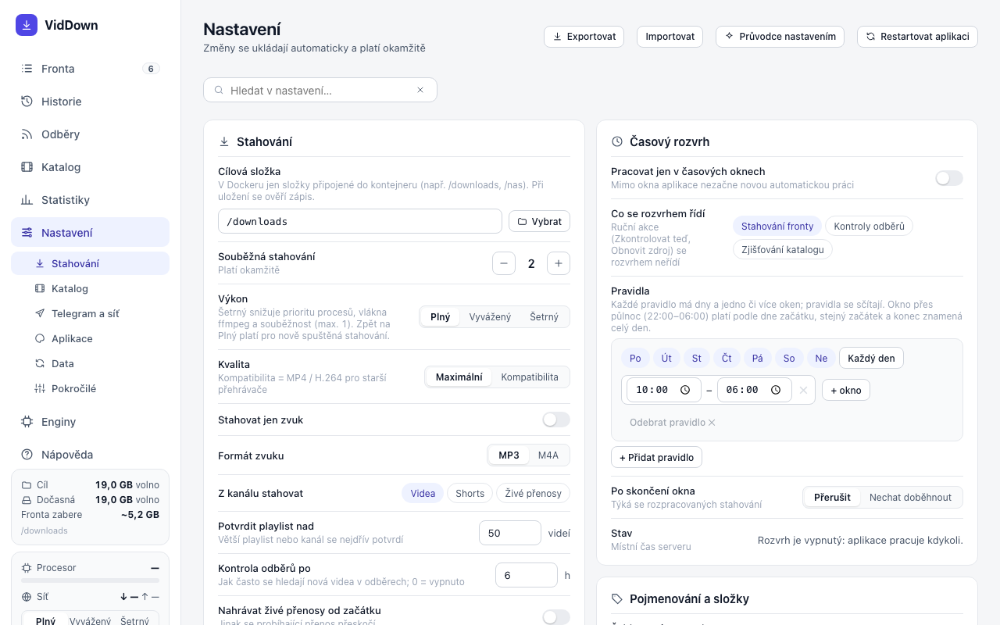
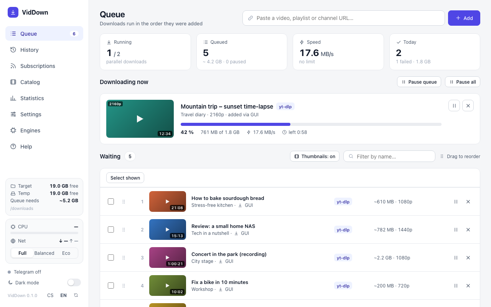
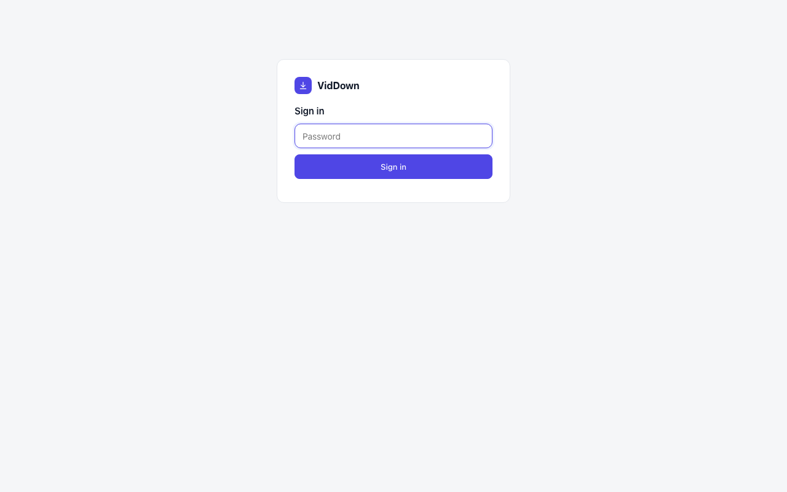
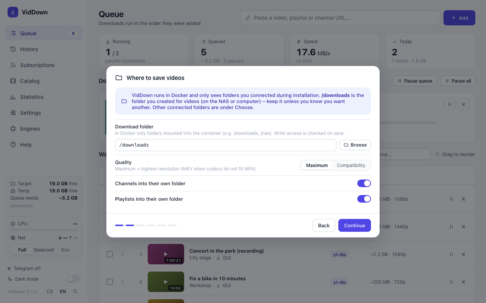
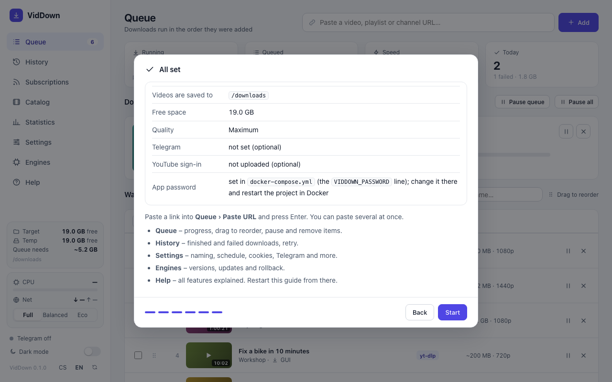
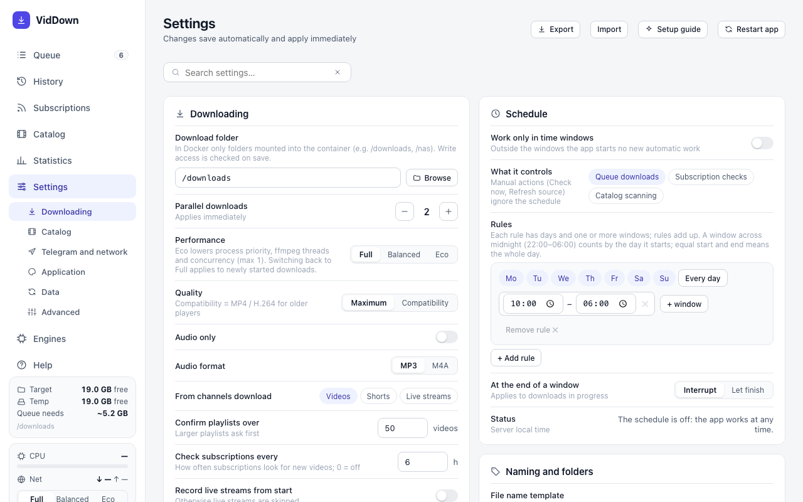

# VidDown

**[Čeština](#cesky)** · **[English](#english)**

<a id="cesky"></a>

Stahování videí z webových stránek, playlistů a celých kanálů do složky na vašem NAS nebo počítači.
Běží v **Dockeru** (Synology NAS, Windows, Mac, Linux; procesory Intel/AMD i ARM). Ovládá se **v prohlížeči**, **Telegram botem**
i **příkazy v terminálu**.



- **YouTube a tisíce dalších webů** přes [yt-dlp](https://github.com/yt-dlp/yt-dlp).
- **Ostatní stránky** přes vestavěný **HLS sniffer**: neviditelný prohlížeč (Chromium) načte stránku, odposlechne stream (`.m3u8`, DASH, MP4) a ffmpeg ho stáhne a spojí. Když yt-dlp video nenajde, automaticky se zkusí sniffer.
- **Jedna fronta**, stahuje se v pořadí přidání. V GUI jde měnit pořadí přetažením (nebo Alt + šipky), pozastavit a odstranit položky.
- **Nejvyšší kvalita** je výchozí. Vedle každého videa se uloží miniatura `Název videa.jpg`.
- **Playlisty a kanály** se stáhnou celé (u kanálu jen záložka Videa, Shorts a živé přenosy volitelně), do vlastní složky.
- **Katalog:** projděte si videa z kanálů jako mřížku náhledů a stáhněte jen ta, která chcete.
- **Telegram:** pošlete botovi odkaz, odpoví počtem nalezených videí a rozlišením prvního. Pak hlásí jen chyby videí, která jste zadali přes Telegram, a důležitá systémová oznámení.
- **Enginy** (yt-dlp, Deno, ffmpeg) se aktualizují s testem. Když nová verze nefunguje, zůstane předchozí. **Aplikace** se umí aktualizovat sama z GitHubu.
- Nastavení: souběžná stahování, limit rychlosti, časový rozvrh, šablona názvů, cookies, proxy, heslo, čeština i angličtina, světlý i tmavý režim.

> Používejte jen pro obsah, ke kterému máte práva. DRM (Netflix, Disney+ apod.) se neobchází.

## Instalace krok za krokem

Vyberte, kde má VidDown běžet. Stačí jedna z možností.

<details>
<summary><b>A) Synology NAS</b> (doporučeno: běží pořád, i když je počítač vypnutý)</summary>

Potřebujete NAS s procesorem Intel/AMD nebo ARM a systémem DSM 7.2 nebo novějším.

**1. Nainstalujte Container Manager**

1. Otevřete DSM v prohlížeči a přihlaste se.
2. Otevřete **Centrum balíčků** (Package Center).
3. Vyhledejte **Container Manager**.
4. Když vidíte tlačítko **Instalovat**, klikněte na něj a počkejte. Když vidíte **Otevřít**, je už nainstalovaný.

**2. Vytvořte složky**

1. Otevřete **File Station**.
2. Otevřete složku **docker** (vytvořil ji Container Manager).
3. Klikněte na **Vytvořit › Vytvořit složku** a pojmenujte ji `viddown`.
4. Otevřete složku `viddown` a vytvořte v ní složku `data`.
5. Vytvořte složku pro videa, například ve sdílené složce **video** složku `VidDown`.

**3. Vytvořte projekt**

1. Otevřete **Container Manager** a vlevo klikněte na **Projekt**.
2. Klikněte na **Vytvořit**.
3. **Název projektu:** `viddown`.
4. **Cesta:** klikněte na **Nastavit cestu** a vyberte `docker` › `viddown`.
5. **Zdroj:** zvolte **Vytvořit docker-compose.yml**.
6. Do velkého pole vložte tento text:

   ```yaml
   services:
     viddown:
       image: ghcr.io/iamjk78/viddown:latest
       container_name: viddown
       restart: unless-stopped
       ports:
         - "8765:8765"
       environment:
         TZ: Europe/Prague
         PUID: "1026"
         PGID: "100"
         VIDDOWN_PASSWORD: "ZMENTE-TOTO-HESLO"
       volumes:
         - /volume1/docker/viddown/data:/data
         - /volume1/video/VidDown:/downloads
   ```

7. V textu změňte **dvě věci**:
   - `ZMENTE-TOTO-HESLO` na vlastní heslo (aspoň 6 znaků). Tímto heslem se budete přihlašovat do aplikace.
   - `/volume1/video/VidDown` na složku pro videa z kroku 2. Cestu najdete ve File Station: pravé tlačítko na složku › **Vlastnosti** › **Umístění**.
8. Klikněte na **Další**. Na stránce **Web Portal** nic nezaškrtávejte a klikněte na **Další**.
9. Klikněte na **Hotovo**. NAS stáhne aplikaci (pár minut). Když je u projektu **zelená tečka**, běží.

**4. Otevřete aplikaci**

V prohlížeči zadejte adresu NAS s číslem `:8765`, například `http://192.168.1.20:8765`. Pokračujte částí **První spuštění** níže.

</details>

<details>
<summary><b>B) Počítač s Docker Desktop</b> (Windows nebo Mac)</summary>

Aplikace běží, jen když je počítač zapnutý a Docker Desktop spuštěný.

**1. Nainstalujte Docker Desktop**

1. Stáhněte Docker Desktop z [docker.com](https://www.docker.com/products/docker-desktop/) a nainstalujte ho.
2. Spusťte ho a počkejte, až se v liště (Windows: vpravo dole, Mac: nahoře) objeví ikona velryby a napíše, že běží.

**2. Připravte složku**

1. V Dokumentech vytvořte složku `VidDown`.
2. Otevřete tento soubor: [docker-compose.desktop.yml](https://raw.githubusercontent.com/iamjk78/VidDown/main/docker-compose.desktop.yml).
3. Uložte ho do složky `VidDown` pod názvem **`docker-compose.yml`** (v prohlížeči: pravé tlačítko › Uložit jako, nebo Ctrl+S / Cmd+S).

**3. Spusťte aplikaci**

- **Windows:** otevřete složku `VidDown`, klikněte do řádku s adresou nahoře, napište `cmd` a stiskněte Enter.
- **Mac:** otevřete aplikaci **Terminál** a napište `cd ~/Documents/VidDown` a Enter.

Pak napište tento příkaz a stiskněte Enter:

```bash
docker compose up -d
```

Docker stáhne aplikaci (pár minut). Videa se budou ukládat do složky `VidDown/Videa`.

**4. Otevřete aplikaci**

V prohlížeči zadejte `http://localhost:8765`. Pokračujte částí **První spuštění** níže.

</details>

### První spuštění

1. **Přihlaste se** heslem, které jste zadali v `VIDDOWN_PASSWORD` (na počítači s Docker Desktop se heslo nechce).

   

2. Otevře se **průvodce nastavením**. Klikejte na **Pokračovat**:
   - **Kam ukládat videa:** nechte `/downloads`. To je složka pro videa, kterou jste vytvořili při instalaci.

     

   - **Jak stahovat:** kolik videí najednou a případně omezení rychlosti nebo časové okno.
   - **Telegram (volitelné):** pokud chcete posílat odkazy z telefonu, postupujte podle návodu v okně.
   - **Přihlášení k YouTube (volitelné):** potřeba jen pro videa s věkovým omezením. Jde přeskočit a nahrát později.
   - **Hotovo:** shrnutí. Zkontrolujte, kam se ukládá a kolik je volného místa.

     

3. **Stáhněte první video:** zkopírujte odkaz na video (třeba z YouTube), vložte ho do pole nahoře na stránce **Fronta** a stiskněte Enter.

Průvodce jde kdykoli spustit znovu v **Nastavení › Průvodce nastavením**.



### Aktualizace

- **Aplikace** se aktualizuje sama zevnitř. Když vyjde nová verze, uvidíte nahoře v aplikaci pruh s tlačítkem **Aktualizovat**
  (a zprávu v Telegramu, je-li zapnutý). Klikněte na něj. Aplikace novou verzi stáhne, otestuje a restartuje se. Když by nová verze
  nefungovala, sama se vrátí ke staré. V **Nastavení › Aplikace** můžete zapnout i automatické aktualizace.
- **Nový obraz** je potřeba jen výjimečně (aplikace to sama napíše: „vyžaduje novější obraz“):
  - **Synology:** Container Manager › **Projekt** › `viddown` › **Akce › Zastavit**, pak **Obraz** › `ghcr.io/iamjk78/viddown` ›
    **Aktualizovat** (pokud tlačítko nevidíte, použijte **Projekt** › `viddown` › **Akce › Sestavit**) a projekt znovu spusťte.
  - **Docker Desktop:** ve složce `VidDown` spusťte `docker compose pull` a pak `docker compose up -d`.

Nastavení, historie a stažená videa se při aktualizaci nemažou.

### Když něco nefunguje

| Co vidíte | Co udělat |
|---|---|
| Stránka `:8765` se neotevře | Počkejte 1–2 minuty po spuštění. Na Synology zkontrolujte zelenou tečku u projektu, na počítači ikonu Docker Desktop. |
| „Do složky nejde zapisovat“ | Synology: File Station › pravé tlačítko na složku pro videa › **Vlastnosti › Oprávnění** › **Vytvořit** › skupina **users** › Čtení i zápis. Pak projekt restartujte. |
| Zapomenuté heslo | Změňte `VIDDOWN_PASSWORD` v projektu (Synology: Projekt › `viddown` › Upravit) a projekt restartujte. |
| Video z YouTube „vyžaduje přihlášení / věk“ | Nahrajte cookies: **Nastavení › Pokročilé › Cookies** (návod je přímo tam). |
| Aplikace hlásí „cílová složka není dostupná“ | Složka pro videa není připojená (např. odpojený disk). Fronta počká a po návratu sama pokračuje. |

Podrobný popis všech funkcí je v aplikaci v **Nápovědě**.

---

## Podrobnosti

### Pro pokročilé: Docker Compose, vlastní složky, sestavení obrazu

Obraz `ghcr.io/iamjk78/viddown` je veřejný a obsahuje verzi pro Intel/AMD (`linux/amd64`) i ARM (`linux/arm64`); Docker si
sám vybere tu správnou. Vzorové soubory: [docker-compose.synology.yml](docker-compose.synology.yml),
[docker-compose.desktop.yml](docker-compose.desktop.yml) a pro vývoj ze zdrojového kódu [docker-compose.yml](docker-compose.yml)
(`docker compose up -d --build`).

V `docker-compose.yml` nastavte `TZ` (plánování), `PUID`/`PGID` (vlastník souborů) a případně Telegram.
Pro přístup ze sítě musí být nastavené `VIDDOWN_PASSWORD`.

**Cílová složka (např. síťová složka na NAS).** Kontejner vidí jen připojené složky. Připojte nadřazenou složku
a konkrétní cíl pak zvolte v GUI (Nastavení › Stahování › Cílová složka). Místní připojení dejte do
`docker-compose.override.yml` (necommituje se), Docker Compose ho načte automaticky:

```yaml
services:
  viddown:
    environment:
      PUID: "501"   # id -u
      PGID: "20"    # id -g
    volumes:
      - /mnt/nas:/nas           # připojené síťové sdílení
      # - /volume1:/nas         # Synology: celý svazek
```

V GUI pak zadejte cestu uvnitř kontejneru, např. `/nas/Videos`. Při uložení se ověří,
že složka leží na připojeném svazku a že do ní jde zapisovat. Jinak se uložení odmítne s vysvětlením.
Když cílová složka za provozu přestane být dostupná (odpojený NAS), fronta se pozastaví a po obnovení
přístupu sama pokračuje. Už stažené video počká v dočasné složce a znovu se nestahuje.

> **macOS a síťový disk:** Docker Desktop na Macu se síťovým diskem (SMB) připojeným do kontejneru umí zablokovat celý systém
> (zaseknutý ovladač SMB v macOS). Videa na NAS proto raději stahujte přímo aplikací běžící na NAS (možnost A).

**Vydání nové verze (GitHub Actions).** Zvyšte verzi v `src/viddown/__init__.py`, commitněte a pošlete značku:

```bash
git tag v0.2.0 && git push origin main v0.2.0
```

Workflow [.github/workflows/release.yml](.github/workflows/release.yml) sestaví obraz pro Intel i ARM, nahraje ho jako
`ghcr.io/iamjk78/viddown:<verze>` a `:latest` a vytvoří GitHub Release s archivem aplikace a manifestem (z něj se aplikace
aktualizuje zevnitř). Ručně z vlastního počítače jde totéž bez GitHub Actions: `scripts/release.sh`.

**Přesun existující instalace (např. z počítače) na Synology:**

1. Na starém počítači zastavte VidDown (`docker compose down`) – Telegram bot smí běžet jen na jednom místě.
2. Zkopírujte složku `data` na NAS (např. `/volume1/docker/viddown/data`), **bez** podsložek `engines/`, `tmp/` a `ms-playwright/`
   (jsou pro jinou architekturu procesoru; na NAS se samy znovu stáhnou při prvním spuštění). Soubor `backup.key` zkopírujte také,
   jinak na NAS neotevřete zálohy vytvořené na starém počítači.
3. Spusťte projekt. Pokud se cesta ke složce s videi změnila, zadejte v GUI (Nastavení › Cílová složka) novou, např. `/downloads`.
4. Přepište cesty stažených souborů v historii, ať se videa nehlásí jako smazaná:

   ```bash
   docker exec viddown viddown db remap-paths /nas/Videos /downloads --dry-run
   docker exec viddown viddown db remap-paths /nas/Videos /downloads
   ```
5. Token Telegram bota, cookies, nastavení a seznam už stažených videí (`archive.txt`) se přenesou se složkou `data`.

Jednodušší cesta je záloha a obnova v GUI (Nastavení › Záloha a obnova), včetně přepisu cest.

**Migrace databáze:** verze schématu je v databázi (`pragma user_version`). Při startu se chybějící migrace provedou
automaticky a před tím se uloží záloha `viddown.db.v<stará verze>.bak` vedle databáze. Databázi z novější verze VidDown
starší verze odmítne otevřít (chrání před poškozením při downgradu). Stav ukáže `viddown db info` a `viddown doctor`.

### Katalog

Menu **Katalog** slouží k třídění videí před stahováním: přidáte zdroje (kanály, playlisty, jednotlivá videa), aplikace je **jen prozkoumá**
(nic nestahuje) a videa si pak projdete jako mřížku karet s miniaturou, rozlišením, velikostí a délkou.

- **Šířka:** Katalog využije celou šířku okna (ostatní obrazovky zůstávají vystředěné); mřížka karet přidává sloupce podle šířky (na 4K monitoru
  zhruba 10 karet na řádku při velikosti M) a pruh zdrojů se s oknem také rozšiřuje. Počet karet na řádku ovlivní i velikost miniatur S, M, L.
- **Zdroje vlevo:** zdroje jsou malé odznáčky ve svislém pruhu vlevo od seznamu videí (zkrácený název, počet videí, tečka stavu: zeleně hotovo,
  žlutě čeká nebo se zjišťuje, červeně chyba; od 16 zdrojů se zmenší na kulaté odznáčky s písmenem). **Při najetí** se ukážou podrobnosti
  zdroje. **Kliknutím** se zdroj zvolí (seznam videí se vyfiltruje na něj; druhý klik výběr zruší). Nad odznáčky je jedna sada tlačítek pro zvolený
  zdroj: **Obnovit** (najde jen nová videa; bez zvoleného zdroje „Obnovit všechny“), **Načíst znovu vše**, **Odebrat**. Odebrání se zeptá, zda
  odebrat **jen zdroj** (jeho videa zůstanou v katalogu a půjdou filtrovat jako „odebraný zdroj“; zdroj se přestane zjišťovat a znovupřidání
  stejné adresy ho připojí zpět), nebo **zdroj i jeho videa z katalogu**; fronta stahování a už stažená videa se nemění v žádném případě.
- **Přidání zdrojů:** „Přidat zdroje“ – adresy po jedné na řádek, vložené najednou, nebo ze souboru `.txt` (řádky začínající `#` se
  přeskočí). Adresa, která už v katalogu je, se načte znovu celá. Zdroje se zjišťují ve vlastní frontě, kterou vidíte nahoře
  (stav, počet videí, průběh podrobností); stahování to neblokuje.
- **Weby, které yt-dlp nezná** (typ zdroje „Stránka“): aplikace na stránce najde opakující se odkazy na videa a další stránky seznamu
  (stejně jako u odběru „stránka s videi“). Nejdřív se zkusí **rychle z běžného HTML**; když seznam v HTML není (vykresluje ho
  JavaScript), stránku vykreslí Chromium. Videa se ukládají do složky podle názvu stránky. Podrobnosti takových videí se zjišťují
  **až nakonec, prohlížečem, po jednom** (u karty „podrobnosti nezjištěny“, když video nejde najít). Prohlížeč jde vypnout
  v Nastavení › Katalog („Pomalé weby zjišťovat prohlížečem“).
- **Automatické hledání nových videí:** přepínač **Hledat nová videa automaticky** nahoře v Katalogu a interval (6 h až týden).
  Zdroje se samy znovu prohlédnou a nabídnou jen dosud nenabídnutá videa; řídí se časovým rozvrhem (rozsah „katalog“).
- **Animované náhledy:** v Nastavení › Katalog zapněte „Stahovat animované náhledy“ (výchozí vypnuto; největší velikost jedné animace je
  5 MB, 1 až 20). Když web mezi miniaturami nabízí animaci (GIF, WebP, MP4), uloží se vedle miniatury a karta dostane odznak
  „animace“; **přehraje se, dokud je kurzor kdekoli v rámečku karty** (animace se hledá i na stránce zdroje, kde je web ukazuje u všech videí najednou, a páruje se podle čísla v adrese) (na dotykovém displeji klepnutím na náhled), jinak se nic nepřehrává. Větší animace se nestáhne
  a zůstane statická miniatura. U webů, které nabízejí **storyboard** (okénka z videa, např. YouTube), složí aplikace z několika okének
  rovnoměrně z celého videa krátké smyčkové MP4 (potřebuje ffmpeg, který je v Dockeru i ve správci enginů). Když ani to ne, zkusí aplikace (volba „Hledat animaci i na stránce videa“, jeden dotaz navíc na video, pomalu a až nakonec)
  najít náhledový klip přímo na stránce videa; použije ho jen tehdy, když prokazatelně patří k tomuto videu, ne k doporučeným. Podle animace jde
  **filtrovat** („s animací“ / „bez animace“). U už načtených videí tlačítko **Doplnit animace** znovu zjistí podrobnosti videí bez animace (po jednom
  na web s pauzou) a zkusí znovu ty, které byly nad limitem.
- **Místo a mazání:** Nastavení › Katalog ukazuje velikost miniatur a animací; tlačítko **Smazat animace** je odstraní (statické miniatury zůstanou).
  Animace jsou jen mezipaměť, do zálohy se nepřidávají. U každé karty je ikona **Otevřít stránku videa** na webu a **Zkopírovat adresu**.
- **Podrobnosti** (rozlišení, velikost, délka, větší miniatura) se doplňují postupně, po jednom videu na web s nastavitelnou pauzou
  (Nastavení › Katalog), a až po dokončení seznamů všech zdrojů. U každého zdroje jde zdroj **Obnovit** (najde jen nová videa),
  **Načíst znovu vše** (nabídne znovu i odmítnutá a stažená) a **Odebrat** (smaže i paměť o jeho videích).
- **Procházení:** hledání v názvu videa, kanálu i zdroje (bez ohledu na diakritiku, tlačítko × a klávesa Esc), filtr podle zdroje,
  rozlišení (2160p až ≤360p, neznámé), délky (do 20 s, 1, 2, 5, 10, 30 min, 1 h, nad 1 h, neznámá; navazující intervaly) a stavu (nové, ve frontě, staženo dříve, dříve odmítnuté, nedostupné); řazení podle pořadí
  ve zdroji, zdroje, rozlišení, velikosti, délky, **data zveřejnění** (od nejnovějšího nebo od nejstaršího, i uvnitř zvoleného zdroje; datum se zjišťuje spolu s podrobnostmi, u starších videí ho doplní tlačítko Doplnit data) nebo data přidání; filtr „zveřejněno za poslední týden / měsíc / rok“; ohleduplnost k zdrojovým serverům: pauza mezi dotazy na stejný web (nejméně 1 s), hodinový strop dotazů na web a volitelná záložní proxy, která se zkusí jen po chybě spojení nebo serveru (ne po omezení dotazů); mezi stahováním videí ze stejného webu je vždy pauza (u YouTube výchozích 30 až 60 s) a když web omezí dotazy, stahování z něj se pozastaví na 15, 30 a nakonec 60 minut místo opakovaných neúspěšných pokusů; když ve zdroji nezbude žádné video (odstraněním nebo stažením), aplikace se zeptá, jestli zdroj odebrat, nebo ponechat pro budoucí videa; zdroj, který je seznamem playlistů (např. záložka „Playlisty“ kanálu YouTube), nabídne playlisty k výběru a vybrané přidá jako samostatné zdroje (ve frontě se z nich stáhnou videa do podsložek podle názvu playlistu); 25 až 500 videí na stránku; velikost miniatur S, M, L (pamatuje
  se v prohlížeči).
- **Výběr:** zaškrtnutím karet, **Vybrat zobrazené** (stránka) nebo **Vybrat všech vyhovujících** (i na dalších stránkách; jednotlivé
  karty jde z výběru vyřadit). **Odstranit** (u karty i hromadně) video z katalogu skryje; zdroj si ho pamatuje a nabídne ho znovu až
  po „Načíst znovu vše“ s odznakem „Dříve odmítnuté“. Videa ve frontě stahování se odstranit nedají. **Stáhnout** (u karty i hromadně) zařadí
  videa do fronty se zdrojem „katalog“ a uloží je do podsložky stahování podle názvu zdroje (kanálu nebo playlistu). Video, které už
  bylo staženo dříve, se přeskočí; potvrzením u karty nebo zaškrtnutím „I videa Staženo dříve stáhnout znovu“ se stáhne znovu. Po
  úspěšném stažení video z katalogu zmizí; když stahování selže nebo se zruší, vrátí se do katalogu s odznakem „stahování selhalo“.

### Přehrávání a kontejner souborů

Aplikace **nic nekóduje ani nepřevádí**: přehrávač v historii posílá soubor beze změny. Safari neumí kontejner MKV, Chrome a Edge ano.
YouTube s AV1 nebo VP9 a zvukem Opus se skládá do MKV, proto je v Nastavení › Stahování volba **Po stažení přebalit MKV do MP4**
(výchozí zapnuto): ffmpeg jen **zkopíruje** obraz, zvuk, titulky (text do formátu MP4), obálku a kapitoly do MP4, bez kódování a bez změny kvality
a rozlišení; trvá to sekundy (76 MB za 1 s). Když přebalení selže, zůstane MKV. Už stažené soubory MKV se nemění. Pozn.: že Safari přehraje
konkrétní kombinaci (např. AV1 s Opusem v MP4) záleží na verzi systému a čipu; nelze to z aplikace zaručit. Máte-li jistotu přehrání všude,
nastavte Kvalitu na Kompatibilitu (MP4 s H.264, u některých webů nejvýš 1080p).

### Časový rozvrh

Nastavení › Časový rozvrh určuje, kdy smí aplikace **automaticky** pracovat. Zapnete ho přepínačem a zadáte pravidla: každé pravidlo má
dny v týdnu (nebo „Každý den“) a jedno či více časových oken, např. úterý a čtvrtek 2:00–5:00 a 19:00–21:00. Pravidla se sčítají,
okno přes půlnoc (22:00–06:00) platí podle dne začátku a stejný začátek a konec znamená celý den. Čas je místní čas serveru
(v Dockeru nastavte `TZ`); přechod letního času se řeší sám.

- **Co se řídí** (zaškrtávání): stahování fronty, kontroly odběrů, zjišťování katalogu. Mimo okno nezačne nová automatická práce,
  probíhající kontrola nebo dotaz doběhne. Aktualizace a zálohy se rozvrhem neřídí.
- **Po skončení okna** se rozpracovaná stahování buď přeruší a vrátí do fronty, nebo se nechají doběhnout.
- **Ruční akce** (Zkontrolovat teď u odběru, přidání nebo obnovení zdroje katalogu) se rozvrhem neřídí. Stahování zařazená ručně
  začnou až v okně.
- **Dočasná výjimka:** v banneru „čeká na časové okno“ (ve frontě, v odběrech) i v Nastavení jde rozvrh na 1, 3 nebo 6 hodin obejít.
- Dřívější nastavení jednoho okna se zobrazí jako první pravidlo a po první úpravě se uloží do nového tvaru.
- Ostrou zkoušku v Dockeru spustí `.venv/bin/python scripts/e2e_schedule.py` (jednorázový kontejner, nesahá na běžící VidDown).

### Aktualizace aplikace bez nového obrazu

Aplikace se skládá ze tří vrstev: **obraz** (Python, ffmpeg, Chromium, závislosti; mění se zřídka, příkazem `pull`),
**kód aplikace** (mění se často a aktualizuje se zevnitř) a **enginy** (yt-dlp, ffmpeg, Deno; mají vlastní aktualizace).
Aktualizovaný kód leží v datové složce (`/data/app/<verze>/`), takže přežije restart i `pull` obrazu.

**Nastavení** (Nastavení › Aktualizace aplikace)

1. Repozitář je veřejný, takže token není potřeba. Token (`viddown app token`, proměnná `VIDDOWN_APP_UPDATE_TOKEN`) se hodí jen
   pro vlastní soukromou kopii repozitáře: fine-grained token s právem Contents – Read-only.
2. Zkontrolujte repozitář (`app_update_repo`, výchozí `iamjk78/VidDown`) a zvolte režim:
   **Jen oznámit** (výchozí: banner v GUI a zpráva v Telegramu s tlačítkem Aktualizovat), **Automaticky** (stáhne, otestuje
   a po doběhnutí stahování restartuje; fronta se mezitím měkce pozastaví a po restartu obnoví) nebo **Vypnuto**.
   Interval kontroly je 6 h až 1 týden (výchozí 1 den).

**Vydání nové verze**

1. Zvyšte verzi v `src/viddown/__init__.py`, commitněte a pošlete značku `v<verze>` (`git tag v0.2.0 && git push origin main v0.2.0`).
   GitHub Actions pak udělá totéž co skript níže.
2. Bez GitHub Actions: `scripts/release.sh`. Sestaví archiv kódu a manifest (kontrolní součet, schéma databáze, požadované `IMAGE_API`),
   obraz pro Synology (amd64 i arm64), nahraje obraz do GitHub Container Registry a vytvoří GitHub Release `v<verze>`
   (potřebuje přihlášené `docker login ghcr.io` a `gh auth login`). Před dlouhým sestavováním ověří, že commit je na GitHubu
   a vydání ještě neexistuje. `--dry-run` nic nenahraje, `--app-only` jen sestaví archiv do `dist/release/`.
3. Při změně závislostí (`pyproject.toml`) nebo Dockerfile zvyšte `IMAGE_API` v `src/viddown/bootstrap.py`; skript na to upozorní.
   Takové vydání se do běžícího obrazu nenainstaluje: aplikace jen oznámí, že je potřeba `pull` nového obrazu.

**Co se děje při aktualizaci**

- Aplikace stáhne manifest a archiv, ověří kontrolní součet a velikost, rozbalí ho a spustí **samotest** v odděleném procesu
  nad kopií databáze (verze, načtení všech modulů, migrace a integrita databáze, odpověď API, ffmpeg a yt-dlp). Selže-li,
  verze se odstraní a označí jako přeskočená; běžící verze se nedotkne.
- Před přepnutím se uloží záloha databáze. Nová verze po restartu běží **120 s ve zkušební době**. Pokud dvakrát za sebou
  nenaběhne zdravě (pád, zacyklení), **vrátí se sama předchozí verze**, vadná se přeskočí a (když nová verze databázi migrovala
  dál, než zná stará) se obnoví záloha databáze; poškozená databáze zůstane vedle jako `viddown.db.failed-<verze>`.
  Ruční restart ve zkušební době se do počtu nezapočítává. O návratu se dozvíte bannerem v GUI a zprávou v Telegramu.
- Starší nainstalovaná verze se po `pull` novějšího obrazu zahodí sama (obraz je stejně nový nebo novější).
- Migrace databáze jsou jen přidávací (nové sloupce a tabulky), jinak by návrat na starší verzi nešel.

**Ruční ovládání** (`docker exec viddown viddown app …`)

| Příkaz | Význam |
|---|---|
| `status` | verze, stav zkušební doby, přeskočené verze, poslední události |
| `check` / `update [--force]` | zjistí novější vydání / stáhne, otestuje a připraví (po restartu poběží); `--force` zkusí i přeskočenou verzi |
| `rollback [--restore-db]` | ruční návrat na předchozí verzi (`--restore-db` jen když je databáze novější a smíte přijít o data od přepnutí) |
| `unskip VERZE` / `remove VERZE` | zruší přeskočení / odstraní nainstalovanou verzi |
| `token` | uloží nebo smaže GitHub token |

**Řešení potíží**

| Hlášení | Příčina a řešení |
|---|---|
| „vydání … nenalezeno“ | repozitář (`app_update_repo`) zatím nemá žádné vydání, nebo je soukromý a chybí token |
| „GitHub odmítl přístup“ | token je neplatný, vypršel nebo nemá právo Contents: Read |
| „vyžaduje novější obraz“ | vydání potřebuje vyšší `IMAGE_API`: `docker compose pull && docker compose up -d` |
| „verze X byla přeskočena (důvod)“ | samotest nebo zdravý start selhal; opravené vydání má novou verzi, jinak „Zkusit znovu“ / `update --force` |
| ruční `rollback` odmítl | databáze má novější schéma; návrat je možný jen s `--restore-db` (ztráta dat od přepnutí) |

**Zkouška** (po větších změnách): `scripts/e2e_update.py` v jednorázovém kontejneru a proti falešnému GitHubu projde úspěšnou
aktualizaci, vadnou verzi s pádem při startu a vadnou verzi s migrací databáze (asi 6 minut, na běžící VidDown nesahá).

**Záloha a obnova (export a import):**

- V GUI: Nastavení › Záloha a obnova. „Stáhnout zálohu“ uloží šifrovaný soubor `VidDown_<datum>_<čas>.dtb`, „Vybrat zálohu…“ nahraje zálohu k obnovení (`.dtb` i ZIP).
  Obnova se provede při restartu aplikace; před ní se dosavadní stav uloží do `restore/before-<čas>/` v datové složce (poslední 3).
  Při přesunu na jiný stroj lze zadat „staré → nové“ cesty, které se přepíšou v historii, odběrech i nastavení.
- V terminálu: `viddown backup [soubor.dtb] [--thumbs] [--plain]`, `viddown restore soubor.dtb [--remap STARÁ NOVÁ] [--key KLÍČ]`
  a `viddown backup-key`.
  V Dockeru: `docker exec viddown viddown backup /data/zaloha.zip` (soubor je pak v datové složce na hostiteli).
  Když aplikace běží, `restore` obnovu jen připraví a provede se při jejím dalším startu.
- Záloha obsahuje databázi (konzistentní snapshot i za běhu), `settings.json`, `secrets.json` (heslo, token bota), `cookies.txt`
  a `archive.txt`; volitelně náhledy. **Neobsahuje** enginy, logy a dočasné soubory. Obsahuje tajné údaje – ukládejte ji bezpečně.
  Soubor `.dtb` je šifrovaný AES-256-GCM **klíčem záloh této instalace** (soubor `backup.key` v datové složce, do zálohy se nedostane).
  Na stejné instalaci se obnoví bez zadávání čehokoli. Na jiném počítači nebo po přeinstalování je potřeba klíč záloh: ukáže ho
  Nastavení › Záloha a obnova › **Klíč záloh** (nebo `viddown backup-key`). Uložte si ho do správce hesel. Starší zálohy (do
  verze 0.1.0, klíč zabudovaný v aplikaci) jde dál obnovit.
  `--plain` (v GUI „bez šifrování“) uloží obyčejný ZIP.
- Záloha z novější verze, než kterou používáte, se odmítne (nejdřív aktualizujte aplikaci).
- **Automatické zálohy:** Nastavení › Záloha a obnova. Zapnete přepínač, zvolíte jak často (6 h, 12 h, 1 den, 3 dny, 1 týden),
  složku a kolik záloh uchovat. Po zapnutí se první záloha vytvoří hned, další podle intervalu. Nová záloha se po vytvoření ověří
  a teprve potom se smažou nejstarší nad zadaný počet (maže se jen to, co se jmenuje `VidDown_<datum>_<čas>.dtb`).
  Selže-li záloha (např. nepřipojený NAS), nic se nemaže, po hodině se to zkusí znovu a při selhání přijde zpráva do Telegramu
  (nejvýš jednou denně). Zálohy ve složce jsou v GUI vidět s tlačítkem „Obnovit“.
  Prázdná složka = `backups` v datové složce; proti ztrátě disku zvolte jiné místo. V Dockeru musí být složka připojená jako
  svazek (viz zakomentovaný příklad `/backups` v compose souborech).

### Ze zdrojového kódu

Vyžaduje Python 3.10+.

```bash
python3 -m venv .venv
.venv/bin/pip install -e .
.venv/bin/python -m playwright install chromium-headless-shell
.venv/bin/viddown
```

## Použití

| Příkaz | Co dělá |
|---|---|
| `viddown` | spustí aplikaci a otevře GUI |
| `viddown serve [--open]` | spustí aplikaci (fronta, GUI, Telegram) |
| `viddown add URL [URL…] [--yes]` | přidá do fronty, `--yes` potvrdí velké playlisty; když aplikace neběží, spustí ji na pozadí |
| `viddown queue` / `viddown history` | vypíše frontu / historii |
| `viddown engine status\|update\|test\|rollback [engine] [verze]` | správa enginů |
| `viddown config get [klíč]` / `viddown config set klíč hodnota` | nastavení |
| `viddown password` | heslo do GUI |
| `viddown telegram --token … --chat …` | Telegram bot |
| `viddown autostart on\|off\|status` | spouštění po přihlášení (LaunchAgent / registr / systemd) |
| `viddown doctor` | kontrola závislostí |

Frontu zpracovává vždy jen jeden proces (zámek). CLI zapisuje do stejné databáze, takže běžící aplikace převezme úlohy okamžitě.

### Telegram bot

Ve skupinovém chatu smějí bota ovládat jen uživatelé uvedení v nastavení `telegram_user_ids` (čárkami oddělená ID uživatelů; prázdné = skupina se ignoruje). Osobní chat se ověřuje podle ID chatu. Aktualizace a restart aplikace jdou jen z osobního chatu.

1. V Telegramu otevřete **@BotFather**, pošlete `/newbot` a zkopírujte token.
2. Token vložte v **Nastavení › Telegram** (nebo `viddown telegram --token …`).
3. Napište botovi. Odpoví vaším chat ID – vložte ho do pole **Povolené chat ID**.

Použijte samostatného bota: jeden token nemůže číst zprávy ve dvou aplikacích zároveň.

## Kde jsou data

| Systém | Datová složka |
|---|---|
| macOS | `~/Library/Application Support/VidDown` |
| Windows | `%APPDATA%\VidDown` |
| Linux | `~/.local/share/viddown` |
| Docker | `/data` |

Obsahuje `settings.json`, `secrets.json` (token a hash hesla, práva 600), `backup.key` (klíč záloh, práva 600), `viddown.db`, `engines/`, `thumbs/`, `logs/` a `archive.txt` (už stažená videa). Jinou složku nastavíte proměnnou `VIDDOWN_DATA`.

Proměnné prostředí (mají přednost před nastavením v GUI a zamknou ho): `VIDDOWN_DOWNLOAD_DIR`, `VIDDOWN_TEMP_DIR`, `VIDDOWN_CONCURRENCY`, `VIDDOWN_PORT`, `VIDDOWN_HOST`, `VIDDOWN_LANGUAGE`, `VIDDOWN_PASSWORD`, `VIDDOWN_TELEGRAM_TOKEN`, `VIDDOWN_TELEGRAM_CHAT_ID`, `VIDDOWN_ALLOW_NO_PASSWORD`. `VIDDOWN_DEFAULT_DOWNLOAD_DIR` cílovou složku jen předvyplní a v GUI zůstane měnitelná (používá ji Docker obraz).

## Vývoj

```bash
.venv/bin/pip install -e ".[dev]"
.venv/bin/python -m pytest -q          # testy (integrační test snifferu potřebuje ffmpeg a Chromium)
VIDDOWN_DATA=$PWD/.devdata .venv/bin/viddown serve
.venv/bin/python scripts/demo_data.py /tmp/vd-demo --serve   # ukázková data a GUI na http://127.0.0.1:8798 (snímky do README)
```

Struktura:

```
src/viddown/
  config.py      nastavení a citlivé údaje
  db.py          SQLite: fronta, historie
  engines.py     verzované enginy s testem a návratem
  probe.py       kontrola URL (počet videí, rozlišení, miniatura)
  resolvers/     yt-dlp a HLS sniffer
  runner.py      fronta: pořadí, souběžnost, pauzy, plánování, opakování
  server.py      HTTP API
  web/           GUI (HTML, CSS, JS bez build kroku)
  telegram.py    Telegram bot
  daemon.py      jeden proces: fronta + GUI + bot
  cli.py         příkazy
```

Plán a pravidla chování jsou v [PLAN.md](PLAN.md). Návrhy GUI v [design/](design/).

## Inspirace

Detekce HLS a práce s m3u8 vychází z myšlenek projektu [puemos/hls-downloader](https://github.com/puemos/hls-downloader) (MIT).

---

<a id="english"></a>

# VidDown (English)

Download videos from web pages, playlists and whole channels to a folder on your NAS or computer.
Runs in **Docker** (Synology NAS, Windows, Mac, Linux; Intel/AMD and ARM processors). Controlled **in the browser**, by a
**Telegram bot** and from the **terminal**.



- **YouTube and thousands of other sites** via [yt-dlp](https://github.com/yt-dlp/yt-dlp).
- **Other pages** via the built-in **HLS sniffer**: a hidden browser (Chromium) opens the page, captures the stream (`.m3u8`, DASH, MP4) and ffmpeg downloads it. When yt-dlp finds nothing, the sniffer is tried automatically.
- **One queue**, downloads run in the order they were added. Reorder by dragging (or Alt + arrows), pause and remove items.
- **Best quality** by default. A thumbnail `Video name.jpg` is saved next to every video.
- **Playlists and channels** are downloaded whole, into their own folder.
- **Catalog:** browse the videos of channels as a grid of thumbnails and download only the ones you want.
- **Telegram:** send the bot a link; it replies with the number of videos found and the resolution, then only reports errors.
- **Engines** (yt-dlp, Deno, ffmpeg) update with a test and roll back on failure. The **app** can update itself from GitHub.
- Settings: parallel downloads, speed limit, schedule, file name template, cookies, proxy, password, Czech and English, light and dark mode.

> Only use it for content you have the rights to. DRM (Netflix, Disney+ etc.) is not circumvented.

## Installation step by step

Choose where VidDown should run. One option is enough.

<details>
<summary><b>A) Synology NAS</b> (recommended: always on, even when your computer is off)</summary>

You need a NAS with an Intel/AMD or ARM processor and DSM 7.2 or newer.

**1. Install Container Manager**

1. Open DSM in your browser and sign in.
2. Open **Package Center**.
3. Search for **Container Manager**.
4. If you see **Install**, click it and wait. If you see **Open**, it is already installed.

**2. Create folders**

1. Open **File Station**.
2. Open the **docker** folder (Container Manager created it).
3. Click **Create › Create folder** and name it `viddown`.
4. Open `viddown` and create a folder `data` inside it.
5. Create a folder for the videos, for example `VidDown` in the shared folder **video**.

**3. Create the project**

1. Open **Container Manager** and click **Project** on the left.
2. Click **Create**.
3. **Project name:** `viddown`.
4. **Path:** click **Set path** and choose `docker` › `viddown`.
5. **Source:** choose **Create docker-compose.yml**.
6. Paste this text into the big field:

   ```yaml
   services:
     viddown:
       image: ghcr.io/iamjk78/viddown:latest
       container_name: viddown
       restart: unless-stopped
       ports:
         - "8765:8765"
       environment:
         TZ: Europe/Prague
         PUID: "1026"
         PGID: "100"
         VIDDOWN_PASSWORD: "CHANGE-THIS-PASSWORD"
       volumes:
         - /volume1/docker/viddown/data:/data
         - /volume1/video/VidDown:/downloads
   ```

7. Change **two things** in the text:
   - `CHANGE-THIS-PASSWORD` to your own password (at least 6 characters). You will sign in to the app with it.
   - `/volume1/video/VidDown` to the video folder from step 2. File Station shows the path: right-click the folder › **Properties** › **Location**.
   - Optionally change `TZ` to your time zone (for example `Europe/London`).
8. Click **Next**. On the **Web Portal** page leave everything unchecked and click **Next**.
9. Click **Done**. The NAS downloads the app (a few minutes). A **green dot** next to the project means it is running.

**4. Open the app**

In your browser, type the address of the NAS with `:8765`, for example `http://192.168.1.20:8765`. Continue with **First start** below.

</details>

<details>
<summary><b>B) A computer with Docker Desktop</b> (Windows or Mac)</summary>

The app only runs while the computer is on and Docker Desktop is running.

**1. Install Docker Desktop**

1. Download Docker Desktop from [docker.com](https://www.docker.com/products/docker-desktop/) and install it.
2. Start it and wait until the whale icon appears (Windows: bottom right, Mac: top bar) and says it is running.

**2. Prepare a folder**

1. In Documents, create a folder `VidDown`.
2. Open this file: [docker-compose.desktop.yml](https://raw.githubusercontent.com/iamjk78/VidDown/main/docker-compose.desktop.yml).
3. Save it into the `VidDown` folder as **`docker-compose.yml`** (in the browser: right-click › Save as, or Ctrl+S / Cmd+S).

**3. Start the app**

- **Windows:** open the `VidDown` folder, click into the address bar at the top, type `cmd` and press Enter.
- **Mac:** open the **Terminal** app, type `cd ~/Documents/VidDown` and press Enter.

Then type this command and press Enter:

```bash
docker compose up -d
```

Docker downloads the app (a few minutes). Videos are saved to `VidDown/Videa`.

**4. Open the app**

In your browser, open `http://localhost:8765`. Continue with **First start** below.

</details>

### First start

1. **Sign in** with the password from `VIDDOWN_PASSWORD` (Docker Desktop on your own computer asks for no password).

   

2. The **setup guide** opens. Click **Continue**:
   - **Where to save videos:** keep `/downloads`. That is the video folder you created during installation.

     

   - **How to download:** how many videos at once, optionally a speed limit or a time window.
   - **Telegram (optional):** to send links from your phone, follow the steps in the window.
   - **YouTube sign-in (optional):** only needed for age-restricted videos. You can skip it and upload later.
   - **All set:** a summary. Check where videos are saved and how much free space there is.

     

3. **Download your first video:** copy a link to a video (for example from YouTube), paste it into the field at the top of the **Queue** page and press Enter.

You can start the guide again any time in **Settings › Setup guide**. The app language is switched at the bottom left (**CS / EN**).



### Updating

- **The app** updates itself. When a new version is out, a bar with an **Update** button appears at the top of the app (and a
  Telegram message, if enabled). Click it. The app downloads the new version, tests it and restarts. If the new version does not
  work, it returns to the old one by itself. **Settings › App** can also switch on automatic updates.
- **A new image** is needed only rarely (the app tells you: “requires a newer image”):
  - **Synology:** Container Manager › **Project** › `viddown` › **Action › Stop**, then **Image** › `ghcr.io/iamjk78/viddown` ›
    **Update** (if you do not see the button, use **Project** › `viddown` › **Action › Build**) and start the project again.
  - **Docker Desktop:** in the `VidDown` folder run `docker compose pull` and then `docker compose up -d`.

Settings, history and downloaded videos are kept when updating.

### If something does not work

| What you see | What to do |
|---|---|
| The `:8765` page does not open | Wait 1–2 minutes after starting. On Synology check the green dot next to the project, on a computer the Docker Desktop icon. |
| “Cannot write to the folder” | Synology: File Station › right-click the video folder › **Properties › Permission** › **Create** › group **users** › Read/Write. Then restart the project. |
| Forgotten password | Change `VIDDOWN_PASSWORD` in the project (Synology: Project › `viddown` › Edit) and restart the project. |
| A YouTube video “requires sign-in / age” | Upload cookies: **Settings › Advanced › Cookies** (instructions are right there). |
| “Target folder is not available” | The video folder is not connected (e.g. a disconnected disk). The queue waits and continues by itself. |

All features are described in the app under **Help**. Technical details (Docker Compose, own folders, backups, releases) are in
the Czech part above, section [Podrobnosti](#podrobnosti).
